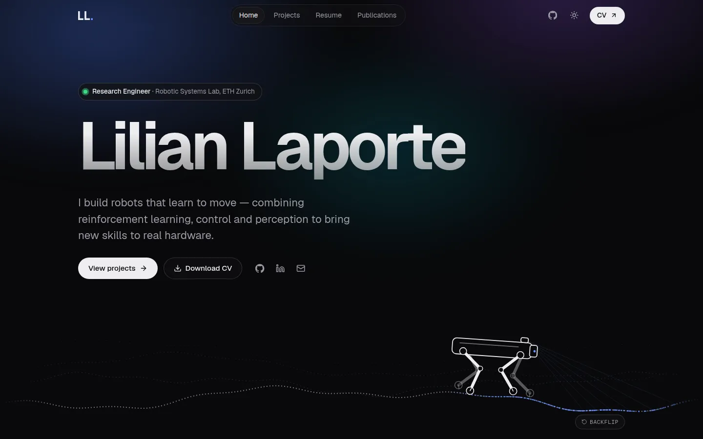

# Lilian Laporte — Portfolio

Personal portfolio: projects, resume and publications. Live at [lilianlaporte.vercel.app](https://lilianlaporte.vercel.app).



## Stack

- [React 19](https://react.dev) + [Vite](https://vite.dev)
- [React Router](https://reactrouter.com) for the pages (`/`, `/projects`, `/resume`, `/publications`)
- Plain CSS with design tokens and automatic light / dark themes (`src/styles/global.css`)
- [Geist](https://vercel.com/font) font, [react-icons](https://react-icons.github.io/react-icons/)

## Getting started

Requires Node.js 22 or newer.

```bash
npm install
npm run dev      # http://localhost:5173
npm run build    # production build in ./build
npm run preview  # serve the production build
```

## Editing content

All content lives in `src/data/`, so updates rarely need component changes:

| File                     | What it holds                                         |
| ------------------------ | ----------------------------------------------------- |
| `profile.js`             | Name, role, tagline, bio, links, languages, interests |
| `projects.js`            | Project cards; `featured: true` shows one on the home page |
| `experience.js`          | Resume timeline: experience, research, education      |
| `publications.js`        | Publications                                          |
| `skills.js`              | Skill groups shown on the home and resume pages       |

The CV is served from `public/Lilian_Laporte_CV.pdf` — replace that file to update it.

### Adding project media

Use short MP4 clips instead of GIFs (they are ~30× smaller). To convert a GIF and grab a poster frame:

```bash
ffmpeg -i clip.gif -an -movflags +faststart -c:v libx264 -crf 26 -pix_fmt yuv420p \
  -vf "scale='min(800,iw)':-2,scale=trunc(iw/2)*2:trunc(ih/2)*2" src/assets/projects/clip.mp4
ffmpeg -i clip.gif -vframes 1 -vf "scale='min(800,iw)':-2" src/assets/projects/clip.webp
```

## Deployment

`npm run build` outputs a static site to `build/`. `vercel.json` rewrites every path to `index.html`
so client-side routes work on refresh; other hosts need the equivalent SPA fallback.

## Credits

Originally based on [soumyajit4419/Portfolio](https://github.com/soumyajit4419/Portfolio); redesigned and rewritten in 2026.
